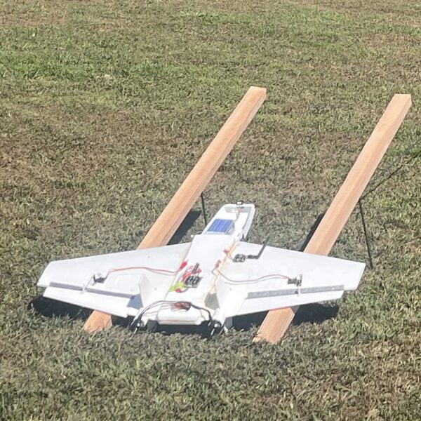
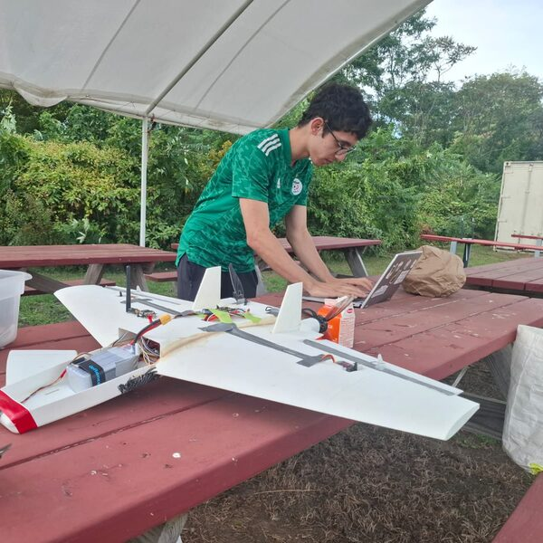
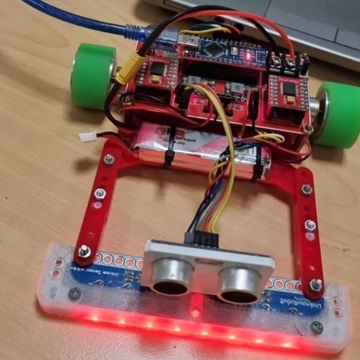

# Mohamed-Essadak Rakah

Mechanical Engineering @ UMass Amherst · UMass Aeronautics (AIAA Design/Build/Fly)

*I build things that fly, think, and move.*

<mrakah@umass.edu> · [LinkedIn](https://www.linkedin.com/in/mohamed-essadak-rakah)

**Open to internships and research positions in robotics, AI, and mechanical engineering.**

---

I'm a second-year mechanical engineering student and an airframe structures engineer on the UMass Aeronautics Design/Build/Fly team. I design, build, and repair robots, drones, and aircraft, from CAD in Onshape to the wiring and flight-controller setup that makes them run, using whatever manufacturing process gets the job done. I learn how a system works, then build my own version.

<table>
  <tr>
    <td align="center" width="33%"> AWRAS 1.2 on the launch catapult I built</td>
    <td align="center" width="33%"> Preflight check before the catapult flight</td>
    <td align="center" width="33%"> Line-tracking robot, 1st place twice</td>
  </tr>
</table>

---

## Projects

### Aerospace & UAVs

| Project | Description |
| --- | --- |
| ✈️ [**AWRAS**](https://github.com/morakah-hub/AWRAS-1.0) 3D-printed flying-wing UAV program | 📐 [**1.0 — Where it started**](https://github.com/morakah-hub/AWRAS-1.0) · fuselage came out too small to build, so it became 1.1. All the design work and analysis lives here. **Start here.** 🛠️ [**1.1 — Built in Qatar**](https://github.com/morakah-hub/AWRAS-1.1) · printed, wired, ready, never got to fly because of logistics. 🚀 [**1.2 — Flew, then crashed**](https://github.com/morakah-hub/AWRAS-1.2) · the catapult got it flying for about 10–15 m before a control issue brought it down.  🔧 [**1.3 — Rebuilding**](https://github.com/morakah-hub/AWRAS-1.3) · the current aircraft, reprinted with changes.|
| [RC Aircraft Development](https://github.com/morakah-hub/RC-Aircraft-Development) | Iterative fixed-wing development documenting the design, construction, testing, failures, and lessons learned across multiple RC aircraft. |
| [Drone Projects](https://github.com/morakah-hub/Drone-Projects) | Multirotor builds focused on FPV systems, electronics integration, and experimental aerial platforms. |

### Robotics & Manufacturing

| Project | Description |
| --- | --- |
| [CNC Router](https://github.com/morakah-hub/cnc-router-umass-aero) | Getting the UMass Aeronautics airframe team off manual carbon fiber cutting. Designed a router from scratch, then sourced a used machine instead and documented why. Modification in progress. |
| [PromptoPal](https://github.com/morakah-hub/Helper-Robot) | Assistive robot that finds a person at scheduled times and prompts them to start daily tasks, built to help people with disabilities get started on their routines. Two-person project; I designed the chassis in Onshape and the power and motor-drive circuitry, and did the wiring and fabrication. |
| [Line Tracking Robot](https://github.com/morakah-hub/line-tracking-robot) | Line-following robot I competed with for OBK Robotics, the club I founded in high school. 1st place at the 15th Arab Robotics Competition (50 teams) and the 16th Qatar Schools Robotics Competition. **My role:** edited and tuned its code, upgraded its motors, kept it running with repairs (motor soldering, tires), and handled the team logistics. The robot itself was inherited, not designed by me. |

---

## Skills

**Design & Manufacturing** `Onshape CAD` `FDM 3D Printing` `Carbon Fiber Layup` `Rapid Prototyping`

**Shop Tools** `3-Axis CNC Router` `Manual Mill` `Drill Press` `Plasma Cutter` `Bandsaw` `Laser Cutter`

**Electronics** `Arduino` `Power Distribution` `Soldering & Wiring` `Sensor Integration`

**Aerospace** `Aircraft Design` `Aerodynamic Analysis (XFOIL)` `Flight Testing` `INAV Flight Controllers` `RC Electronics`

**Software** `Git / GitHub` `MATLAB (coursework)`

---

## Currently working on

- Rebuilding as **AWRAS 1.3** and tracking down the control issue that crashed 1.2
- Getting the team's CNC router ready for its first carbon fiber cuts, now that the new riser plates are installed
- Assembling and testing **PromptoPal** now that the parts are printed and the electronics are soldered
